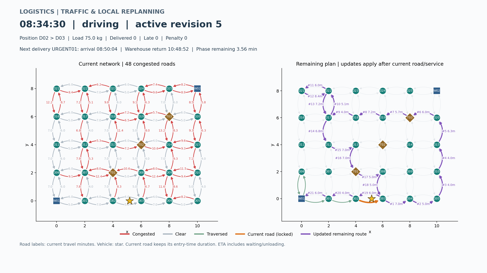

# 电商物流配送路径规划系统

[](https://github.com/Unwiisdey/logistics-route-planner/actions/workflows/ci.yml)

**v1.0.0 最终课程设计版本**。使用 C++17 有向带权图模拟单车辆城市配送，包含订单、窗口、载重、动态插单、路况变化及局部重规划。课程原文需求映射见 [requirements.md](docs/requirements.md)。

[用户手册](docs/user-manual.md) · [设计文档](docs/design.md) · [API](docs/api.md) · [测试报告](docs/test-report.md) · [演示与答辩](docs/demo/README.md) · [版本记录](CHANGELOG.md) · [GitHub Releases](https://github.com/Unwiisdey/logistics-route-planner/releases)

## 运行效果




红色为拥堵道路，紫色为待执行路径，橙色为当前道路，绿色为已走道路，星形为车辆。窗口显示当前位置、载重、下一配送到达时间与返仓 ETA。GIF 是导出模拟状态的加速抽样回放，不是在线地图或实时进程通信。

## 已完成功能

| 模块 | 实现 |
| --- | --- |
| 图与配置 | 邻接表、节点/边增删、邻接矩阵、JSON 校验；30 节点、98 有向道路，2 仓库、25 配送点、3 中转站 |
| 基础规划 | 最小优先队列 Dijkstra，距离/成本策略，最近邻单车辆闭合行程 |
| 订单 | 独立订单 ID、同点多单、硬窗口接单、紧急取送插入、真实仓库取货、全程载重检查 |
| 仿真 | 连续模拟时钟、车辆在边上的位置、等待/卸货、固定超时罚分 |
| 路况 | 默认每 30 秒选取约 10% 道路，增时至少 20% 触发受影响取送区间修复 |
| 优化 | 有界最短路缓存、图版本自动失效、目标提前停止；保留未受影响区间 |
| 展示 | CSV、PNG、GIF、滑块与播放/暂停，历史路线和路况版本一致 |
| 验证 | 本地 Debug / Release 各 96 项 CTest，23 项 Python 测试；多种子缓存对照与性能基准 |

时间单位为分钟，货物 kg、距离 km、费用元。08:00 对应 480。早到等待，在开始卸货时检查闭区间窗口；实际超时每单固定 10 分（可配置），与运输成本分开统计。

## 快速开始

需要 C++17 编译器、CMake 3.16+。JSON 依赖随仓库提供，C++ 构建不需要 Python 或下载第三方库。

Windows / Visual Studio：

```powershell
cmake -S . -B build -A x64
cmake --build build --config Release
ctest --test-dir build -C Release --output-on-failure
.\build\Release\logistics_app.exe --summary --check-size
.\build\Release\logistics_app.exe --plan distance --simulate --scenario config/orders.json --capacity 100 --traffic --export exports/traffic
```

Linux / macOS：

```sh
cmake -S . -B build -DCMAKE_BUILD_TYPE=Release
cmake --build build --parallel 2
ctest --test-dir build --output-on-failure
./build/logistics_app --plan distance --simulate --scenario config/orders.json --capacity 100 --traffic --export exports/traffic
```

示例订单包含成功插入、超载拒绝和窗口拒绝。Windows 本次 seed=42 完成 4 单，0 单超时，0 分处罚，约 10:56:08 空车返仓。不同标准库随机结果可能不同；[保存的演示数据](docs/examples/stage6/README.md) 可直接回放。

## 可视化与一键演示

Python 3.10+；建议在虚拟环境中安装固定依赖：

```sh
python -m pip install -r scripts/requirements.txt
python scripts/demo.py --plots --gif
python scripts/plot_traffic.py --input-dir exports/final-demo/traffic --frame 80 --output exports/traffic.png --show
```

一键演示自动查找构建后的 Release 程序，输出日志、CSV、摘要、PNG 和 GIF；可用 `--app PATH` 指定程序。省略 --plots / --gif 时不需要 matplotlib。详细参数、固定路线与网络图命令见 [用户手册](docs/user-manual.md)。

## 优化与可复现验证

最短路缓存默认容量 256，键为起点、终点、权重类型；图结构或边权变化后按版本失效。即使变化边不在旧路径上也会失效，避免漏掉新形成的捷径。`--cache-capacity 0` 关闭缓存，日志与 path_cache.csv 给出统计。

增量重规划按取货/配送/返仓区间划分，只对含触发道路的区间按耗时找路；当前边与正在服务的订单先完成，其他区间保留。清空缓存不会主动执行全图搜索。单个区间最坏仍可能遍历整个连通分量。

Release、5 轮中位数：1000 节点/4000 边的 480 次重复查询由 480 次搜索降至 32 次，耗时从 179.772 ms 降至 12.355 ms；300 节点的 12 单初始候选规划从 729 次搜索降至 157 次。全部路径与无缓存结果一致。此为特定复用工作负载，非任意场景速度承诺；[完整方法和原始记录](docs/test-report.md)。

```powershell
python -m unittest discover -s tests -p "test_plot*.py" -v
python scripts/benchmark.py --binary build/tests/Release/performance_tests.exe --runs 5 --output exports/benchmark
```

单配置生成器的性能程序为 build/tests/performance_tests。GitHub Actions 配置 Ubuntu / Windows 构建、CTest、Python、端到端演示和绘图；远端状态见页面顶部 badge。

## 工程结构

```text
include/logistics/   model、graph、config、planning、simulation、traffic、visualization 公开接口
src/                 C++17 实现与 CLI
config/              network.json、orders.json、字段说明
scripts/             网络/仿真/路况绘图，一键演示与性能统计
 tests/              单元、边界、集成、性能及 Python 回放测试
 docs/               设计、手册、API、测试报告、需求与历史阶段样例
 docs/demo/          答辩脚本、问答、截图、GIF
 docs/reports/       原始测试结果与性能数据
.github/             双平台 CI、issue / PR 模板
third_party/         nlohmann/json 3.12.0 及 MIT 许可证
```

构建产物 build/、运行导出 exports/、临时工具 work/ 和原始课程 Word 不提交到 Git。模型与算法不依赖具体 GUI。第三方来源和版本见 [依赖说明](third_party/README.md)。项目自身尚未另行指定开源许可证；公开仓库不等于自动授予开源许可。

## 设计限制与版本管理

单车辆；静态最近邻与订单插入均为启发式，不保证整条路线全局最优。两点成本最优的贪心巡回甚至可能比距离贪心更贵，历史示例如实保留。硬窗口是在接单时按当前信息检查，后续拥堵导致的实际违约仍记录固定处罚。当前不提供运行中封路/删边、多车、真实 GPS 或联网交通。

第 1～7 阶段已完成本次要求的交付。代码修改经审查和相关测试后以明确 commit 同步；最终版本使用 v1.0.0 标签和 Release。GitHub 的 [Issues](https://github.com/Unwiisdey/logistics-route-planner/issues) 与 [Milestones](https://github.com/Unwiisdey/logistics-route-planner/milestones) 记录优化、验证、文档展示的验收情况。缺陷报告请附命令、最小配置、种子和工具链。
