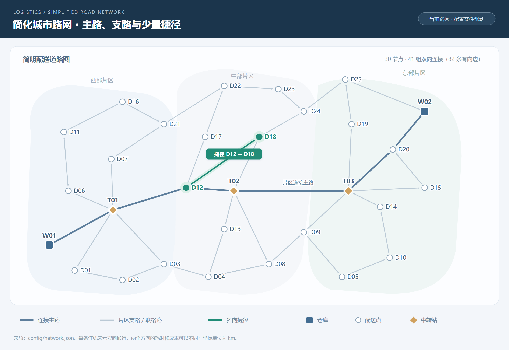
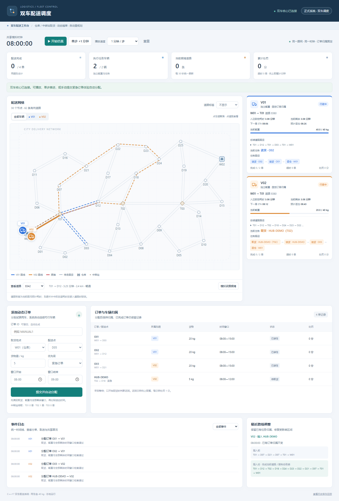
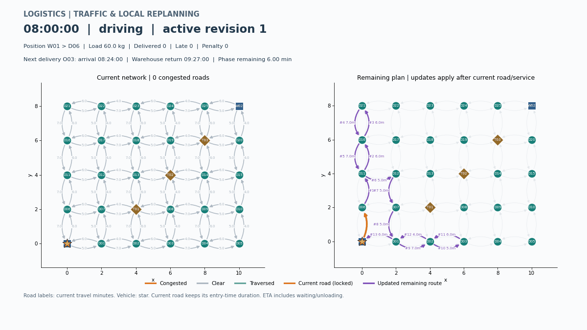

# 电商物流配送路径规划系统

[](https://github.com/Unwiisdey/logistics-route-planner/actions/workflows/ci.yml)

**C++17 物流配送系统（含正式本地 Web 界面）**。使用 C++17 有向带权图模拟单车与双车城市配送，包含订单、窗口、载重、动态插单、路况变化及局部重规划。课程原文需求映射见 [requirements.md](docs/requirements.md)。

[用户手册](docs/user-manual.md) · [设计文档](docs/design.md) · [API](docs/api.md) · [测试报告](docs/test-report.md) · [演示与答辩](docs/demo/README.md) · [项目验收管理](docs/project-management.md) · [版本记录](CHANGELOG.md) · [GitHub Releases](https://github.com/Unwiisdey/logistics-route-planner/releases)

## 运行效果





历史 v1.0.0 网格回放（保留当时的数据和规则）：



红色为拥堵道路，紫色为待执行路径，橙色为当前道路，绿色为已走道路，星形为车辆。窗口显示当前位置、载重、下一配送到达时间与返仓 ETA。GIF 是导出模拟状态的加速抽样回放，不是在线地图或实时进程通信。

## 已完成功能

| 模块 | 实现 |
| --- | --- |
| 图与配置 | 邻接表、节点/边增删、邻接矩阵、JSON 校验；30 节点、82 有向道路，2 仓库、25 配送点、3 中转站 |
| 基础规划 | 最小优先队列 Dijkstra，距离/成本策略，最近邻单车辆闭合行程 |
| 订单 | 独立订单 ID、硬窗口接单、距离/成本路线超时则尝试耗时最短、仓库/中转站真实取货与载重检查 |
| 双车 | 共享路网与时钟、初始分单、订单归属固定、紧急订单分别试算后分配；正式 Web UI / CLI / C++ 均可用 |
| 仿真 | 连续模拟时钟、车辆在边上的位置、等待/卸货、迟到分钟向上取整计罚 |
| 路况 | 默认每 30 秒选取约 10% 道路，增时至少 20% 触发受影响取送区间修复 |
| 优化 | 有界最短路缓存、图版本自动失效、目标提前停止；保留未受影响区间 |
| 展示 | 正式本地 Web 界面、手动插单、当前任务与任务路径；保留 CSV、PNG、GIF 和历史回放 |
| 验证 | 核心历史 Debug / Release 各 96 项 CTest；新版路网与中转站取货加入后 Release 121 项通过，另有 23 项 Python 回放测试 |

时间单位为分钟，货物 kg、距离 km、费用元。08:00 对应 480。早到等待，在开始卸货时检查闭区间窗口；处罚为迟到分钟数向上取整 × 每分钟分值，默认 1 分/分钟；例如迟到 2 分 30 秒计 3 分，与运输成本分开统计。

## 图形界面（推荐）

Windows 双击项目根目录 **Start-UI.cmd**，或运行：

```sh
python scripts/start_ui.py
```

需要 Python 3.9+、CMake 3.16+ 和 C++17 编译器。启动器自动构建 logistics_ui_bridge、生成网页并打开 http://127.0.0.1:8765/ 。网页默认启动 V01/V02 两辆车，每车 40 kg，沿用已批准 Demo 的蓝橙配色、同图双车与独立车辆卡片；可手动插单、查看任务路径、订单归属、共享路况及路线前后对比。网页与 CLI 共用 C++ 核心。保持终端运行，Ctrl+C 停止。

已有构建可加 --no-build；详细操作、耗时解释、测试和端口参数见 [正式 UI 手册](docs/ui-guide.md)。下方快速开始保留 CLI 使用方式。

## 快速开始

需要 C++17 编译器、CMake 3.16+。JSON 依赖随仓库提供，C++ 构建不需要 Python 或下载第三方库。

Windows / Visual Studio：

```powershell
cmake -S . -B build -A x64
cmake --build build --config Release
ctest --test-dir build -C Release --output-on-failure
.\build\Release\logistics_app.exe --summary --check-size
.\build\Release\logistics_app.exe --plan distance --simulate --scenario config/orders.json --capacity 100 --traffic --export exports/traffic
```

Linux / macOS：

```sh
cmake -S . -B build -DCMAKE_BUILD_TYPE=Release
cmake --build build --parallel 2
ctest --test-dir build --output-on-failure
./build/logistics_app --plan distance --simulate --scenario config/orders.json --capacity 100 --traffic --export exports/traffic
```

示例订单包含成功插入、超载拒绝和窗口拒绝。当前 Windows seed=42 的原有演示在新路网中完成 4 单、0 超时、0 分处罚，约 10:00:04 返仓；保存的旧路网演示约 10:56:08 返仓。不同标准库随机结果可能不同；[历史演示数据](docs/examples/stage6/README.md) 可直接回放。

## 中转站取货（已实现）

正式页面的“取货地点”可选择仓库或 T01/T02/T03。订单发布时假定货物已在指定地点备好；车辆必须到站执行取货任务才装货，路过不会自动装货。中转站待取清单由已接受且尚未取货的订单计算；双车分配后归属固定，最终仍返回各自原仓库。

```powershell
.\build\Release\logistics_app.exe --plan distance --simulate --vehicles 2 --scenario config/hub-orders.json --capacity 40 --traffic --export exports/hub-fleet
```

[规则与接口](docs/transfer-stations.md) · [当前路网 SVG](docs/maps/network.svg) · [本次验证](docs/reports/hub-pickup.md)。单车运行将 --vehicles 改为 1、--capacity 改为 100。旧 warehouse_id 订单字段仍可读取，新配置推荐 pickup_node_id。

## 双车运行（CLI）

```powershell
.\build\Release\logistics_app.exe --plan distance --simulate --vehicles 2 --scenario config/orders.json --capacity 40 --traffic --export exports/fleet
```

两辆车共用同一份路网和时钟，各自维护货物、任务与路径。--capacity 是每辆车的上限；默认 V01 / V02 从所选仓库出发。初始订单按优先级/截止时间逐个分配，归属固定；紧急订单对两车分别检查，优先分给能更早送达且不违反已有窗口的车辆。输出分配/拒绝原因、各车日志、总计以及 assignments.csv 和 V01/、V02/ 导出目录。完整规则见 [双车设计与使用](docs/fleet.md)。

**正式 Web UI 已部署双车系统，使用独立 Demo 的界面效果。** 根目录 Start-UI.cmd 或 python scripts/start_ui.py 即可启动；[界面设计与实现](docs/fleet-ui-design.md)。省时兜底已由共用 C++ 核心生效：仅当距离/成本候选会超时，才对同一动作序列尝试耗时最短，并重新检查全部约束。

## 可视化与一键演示

Python 3.10+；建议在虚拟环境中安装固定依赖：

```sh
python -m pip install -r scripts/requirements.txt
python scripts/demo.py --plots --gif
python scripts/plot_traffic.py --input-dir exports/final-demo/traffic --frame 80 --output exports/traffic.png --show
```

一键演示自动查找构建后的 Release 程序，输出日志、CSV、摘要、PNG 和 GIF；可用 `--app PATH` 指定程序。省略 --plots / --gif 时不需要 matplotlib。详细参数、固定路线与网络图命令见 [用户手册](docs/user-manual.md)。

## 优化与可复现验证

最短路缓存默认容量 256，键为起点、终点、权重类型；图结构或边权变化后按版本失效。即使变化边不在旧路径上也会失效，避免漏掉新形成的捷径。`--cache-capacity 0` 关闭缓存，日志与 path_cache.csv 给出统计。

增量重规划按取货/配送/返仓区间划分，只对含触发道路的区间按耗时找路；当前边与正在服务的订单先完成，其他区间保留。清空缓存不会主动执行全图搜索。单个区间最坏仍可能遍历整个连通分量。

Release、5 轮中位数：1000 节点/4000 边的 480 次重复查询由 480 次搜索降至 32 次，耗时从 179.772 ms 降至 12.355 ms；300 节点的 12 单初始候选规划从 729 次搜索降至 157 次。全部路径与无缓存结果一致。此为特定复用工作负载，非任意场景速度承诺；[完整方法和原始记录](docs/test-report.md)。

```powershell
python -m unittest discover -s tests -p "test_plot*.py" -v
python scripts/benchmark.py --binary build/tests/Release/performance_tests.exe --runs 5 --output exports/benchmark
```

单配置生成器的性能程序为 build/tests/performance_tests。GitHub Actions 配置 Ubuntu / Windows 构建、CTest、Python、端到端演示和绘图；远端状态见页面顶部 badge。

## 工程结构

```text
include/logistics/   model、graph、config、planning、simulation、traffic、visualization 公开接口
src/                 C++17 实现与 CLI
config/              network.json、orders.json、字段说明
scripts/             网络/仿真/路况绘图，一键演示与性能统计
ui/                  正式 Web 页面、Python 本地服务与 C++ 桥接
scripts/start_ui.py  一键构建并启动 UI
Start-UI.cmd         Windows 图形界面启动入口
tests/               单元、边界、集成、性能及 Python 回放测试
docs/                设计、手册、API、测试报告、需求与历史阶段样例
docs/demo/           答辩脚本、问答、截图、GIF
docs/reports/        原始测试结果与性能数据
.github/             双平台 CI、issue / PR 模板
third_party/         nlohmann/json 3.12.0 及 MIT 许可证
```

构建产物 build/、运行导出 exports/、临时工具 work/ 和原始课程 Word 不提交到 Git。模型与算法不依赖具体 GUI。第三方来源和版本见 [依赖说明](third_party/README.md)。项目自身尚未另行指定开源许可证；公开仓库不等于自动授予开源许可。

## 设计限制与版本管理

支持单车及基础双车调度；静态最近邻与订单插入均为启发式，不保证整条路线全局最优。两点成本最优的贪心巡回甚至可能比距离贪心更贵，历史示例如实保留。硬窗口是在接单时按当前信息检查，后续拥堵导致的实际违约仍按迟到分钟向上取整计罚。当前不提供运行中封路/删边、跨车转单、真实 GPS 或联网交通。省时兜底在订单硬窗口模式生效；旧静态 Planner 保留原策略。

第 1～7 阶段已完成本次要求的交付。代码修改经审查和相关测试后以明确 commit 同步；最终版本使用 v1.0.0 标签和 Release。GitHub 的 [Issues](https://github.com/Unwiisdey/logistics-route-planner/issues) 与 [Milestones](https://github.com/Unwiisdey/logistics-route-planner/milestones) 记录优化、验证、文档展示的验收情况。缺陷报告请附命令、最小配置、种子和工具链。
