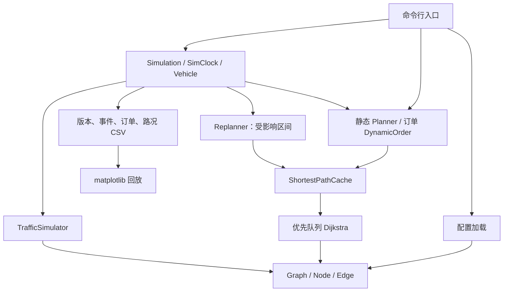

# 系统设计（v1.0.0）

## 目标与边界

实现单车辆电商配送的可复现模拟：有向图、距离/成本规划、独立订单、取货与载重、服务时间窗口、动态订单、路况及增量区间修复。C++17 核心不依赖 GUI；Python 仅读取导出数据。原始题目映射见 [需求拆解](requirements.md)。不包含多车协同、真实 GPS、联网地图、递归子车队或运行中封路。

## 分层

`model` 负责值对象与校验；`graph` 负责网络；`config` 隔离 JSON；`planning` 不修改车辆；`simulation` 是运行状态唯一修改者；`traffic` 生成并校验边权事件；`visualization` 输出可审查数据。

## 数据与不变量

- Graph：节点哈希表 + 按起点分组的邻接向量，空间 O(V+E)。简单有向图；反向道路独立，禁止自环、重复 ID、同方向平行边。矩阵按需生成 O(V²)。当前道路 ID 查询为 O(E)，未伪称常数复杂度。
- Edge：距离 km、耗时分钟、成本元；保存初始耗时与当前耗时。所有权重有限非负；静态关闭道路不参与最短路。
- Order：独立 ID、取货仓库、目的地、数量、窗口、发布时间、优先级。订单不可变，执行结果存于 DeliveryRecord。同一节点可有多个订单。
- Vehicle：载荷始终在 [0, capacity] 内；节点位置与道路位置互斥。在边上保存入边时总耗时、剩余时间，位置线性插值。
- TimeWindow：早到等待；在开始卸货时检查闭区间 [earliest, latest]。实际超时单完成时一次记固定罚分，默认 10 分，与费用分开。
- SimClock：连续 double 分钟，默认 480（08:00）；步长只控制外部推进，内部逐事件处理，不把到达、订单发布或路况时间取整。

## 算法

### 最短路与访问顺序

Dijkstra 使用最小优先队列、重复入堆与过期条目跳过；严格更短才改前驱，避免零权环。出边按目标 ID 排序、堆按距离及 ID 排序，等长结果可复现。单源查询用于最近邻选点，点到点查询在目标出堆时停止。最坏搜索为 O((V+E) log V)，另有邻接排序开销 O(Σ deg(v) log deg(v))，路径重建 O(路径长度)。

静态规划采用最近邻 + Dijkstra，按距离或成本选目标；订单模式按优先级、截止时间逐个插入，动态请求枚举取货/送达插入位置并保留原动作相对次序。紧急订单优先比较本单服务开始时间，再比较距离/成本。候选必须逐站满足取货先后、载重、全部剩余窗口及返仓。启发式失败不证明所有访问顺序都不可行；两点最优也不等于巡回路线全局最优。

### 有界最短路缓存

`ShortestPathCache` 的键为 `(source, target, metric)`，值为完整 PathResult（包括不可达结果）。默认最多 256 项，容量 0 用于关闭；返回值复制，调用者修改结果不会污染缓存。以最近使用序号实现 LRU；有序映射查询 O(log C)，满容量淘汰扫描 O(C)，保存路径空间 O(C × 最大路径长度)。这是有界课程规模缓存，不是无上限全点对矩阵。

Graph 持有不透明的共享版本令牌：未修改的复制图共享令牌；节点、边、耗时或状态发生变化前分配新令牌。缓存持有旧令牌，因此对象地址复用、图赋值、节点 ID 重用都不会错误命中。同值路况和无效删除不改变版本。每次查询发现版本不同就清空所有条目，再搜索。距离/成本路径也失效，因为其返回耗时可能已经变化。

采用整批缓存失效是刻意的正确性选择：**旧路径以外的道路变快也可能产生新最优解**，只删除“包含变化边”的缓存不安全。缓存失效本身不执行 Dijkstra；只有实际请求的区间重新计算。没有共享全局可变缓存，Simulation 拥有自己的实例；直接调用 initial/insert 时创建一次调用内复用的缓存。

### 路况与增量修复

默认每 0.5 模拟分钟、不放回选取 ceil(可模拟道路数 × 0.1) 条边；畅通转拥堵取初始值 1.2～2.0 倍，恢复时还原。零初始耗时/关闭边不参加采样。种子默认 42，同一标准库可复现；跨标准库以保存的 CSV 为准。

阈值按事件前耗时比较，增加至少 20%（比较容差 1e-12）；零转正触发，不变/恢复不触发。当前边与当前等待/卸货不可中断，新的路线从该阶段完成处衔接。按取货、配送、返仓停靠划分区间，只重搜含触发边的区间，目标为最短耗时，其他区间沿用原路。动作顺序和载重不变，随后线性刷新所有后续 ETA。

这是路线区间级增量更新，不是动态最短路树算法。一个受影响区间最坏可能访问整个连通分量；恢复畅通只更新 ETA，不主动改道。若仍无法按时履约，记录预测风险并继续完成已接订单，拒绝会破坏旧窗口的新订单。

## 事件执行与回放

每次 advance 推进到目标时间、当前阶段结束、下次路况事件中最早者。同刻先处理路况，再到达/服务转换，CLI 再处理已经发布的新订单。零耗时阶段立即结算，每次消耗一条边或一个动作，避免空转。空闲返仓后可 wait_until 等待后续请求，路况继续更新。

每版生效路径有 revision；每帧还有待衔接的未来路径、累计路况条目数和真实行驶条目数。回放分别恢复网络、未来路线、当前边和已走道路，不用最终路线解释历史状态。同一时刻多条记录以版本计数区分，支持倒退查看。

图由 Simulation 持有副本；外界修改原图不影响运行。apply_traffic 校验整批输入，修复计算异常时还原已变边权；图版本可能再次变化，但缓存因令牌不同不会使用错误数据。

## 扩展点

性能进一步优化可增加道路 ID 索引、持久化事件流、邻接顺序缓存或更精细的可证明缓存失效策略。真实在线界面可订阅快照；多车、封路、容量分批任务需要先设计新的业务规则。当前 API 保留确定性 apply_traffic、独立订单与只读快照，不提前实现这些功能。
