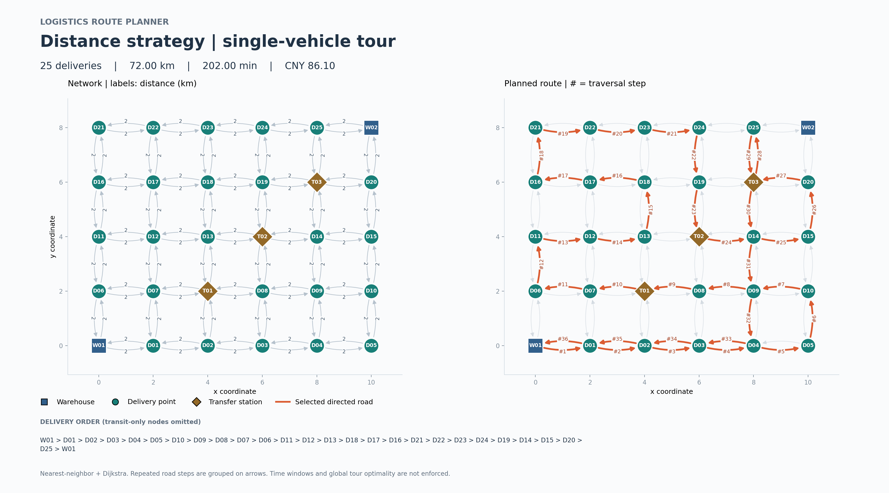
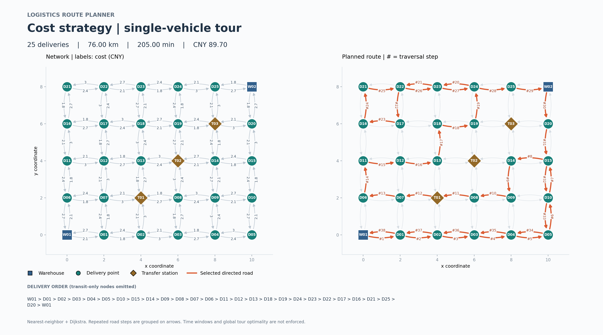

# 第 3 阶段运行示例

使用仓库自带的 30 节点、98 道路网络，从 W01 于模拟日 08:00 出发，完成 25 个配送点并返回 W01。不使用时间窗口约束或载重限制，采用默认零服务时长。

| 策略 | 距离 km | 耗时 min | 成本 元 | 配送点数 |
| --- | ---: | ---: | ---: | ---: |
| distance | 72.00 | 202.00 | 86.10 | 25 |
| cost | 76.00 | 205.00 | 89.70 | 25 |

两种策略均采用最近邻贪心，因此按成本选取下一站并不保证整体费用优于距离策略。本示例保留实际结果，便于后续比较优化算法。

## 距离策略

完整节点序列及统计见 [运行输出](distance-output.txt)，原始绘图数据见 [汇总 CSV](distance/summary.csv)、[逐步路线](distance/route.csv)、[配送停靠顺序](distance/stops.csv)。



## 成本策略

完整节点序列及统计见 [运行输出](cost-output.txt)，原始绘图数据见 [汇总 CSV](cost/summary.csv)、[逐步路线](cost/route.csv)、[配送停靠顺序](cost/stops.csv)。



图左侧显示全部有向道路及当前策略权重，右侧显示所选路线；箭头上的 `#` 是逐条道路遍历的步号，不是节点 ID，也不是订单编号。重复道路以多个步号表示。图中文字采用英文，避免依赖额外中文字体。

## 复现

项目根目录编译后，Windows / Visual Studio 可运行：

```powershell
.\build\Debug\logistics_app.exe --plan distance --warehouse W01 --departure 480 --check-size --export exports/distance
.\build\Debug\logistics_app.exe --plan cost --warehouse W01 --departure 480 --check-size --export exports/cost
python -m pip install -r scripts/requirements.txt
python scripts/plot_network.py --input-dir exports/distance --output exports/distance-route.png
python scripts/plot_network.py --input-dir exports/cost --output exports/cost-route.png
```

Linux/macOS 的可执行文件通常是 `./build/logistics_app`。若采用 README 推荐的虚拟环境，将 python 替换为该环境的解释器路径。上面的命令写到 exports，不覆盖本目录已提交的参考样例。
