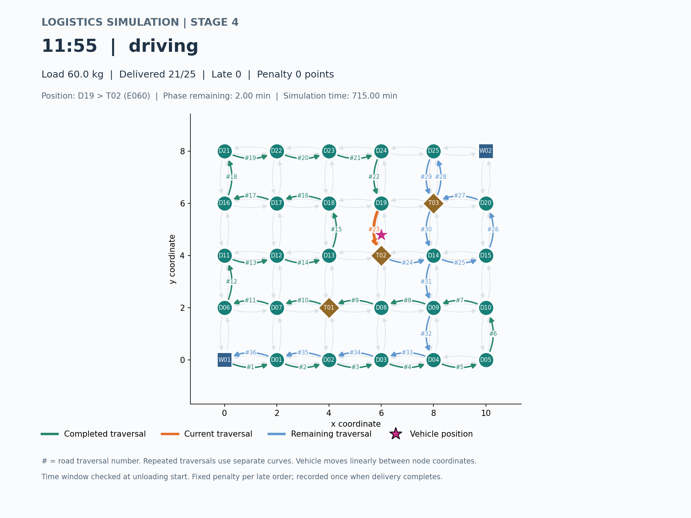
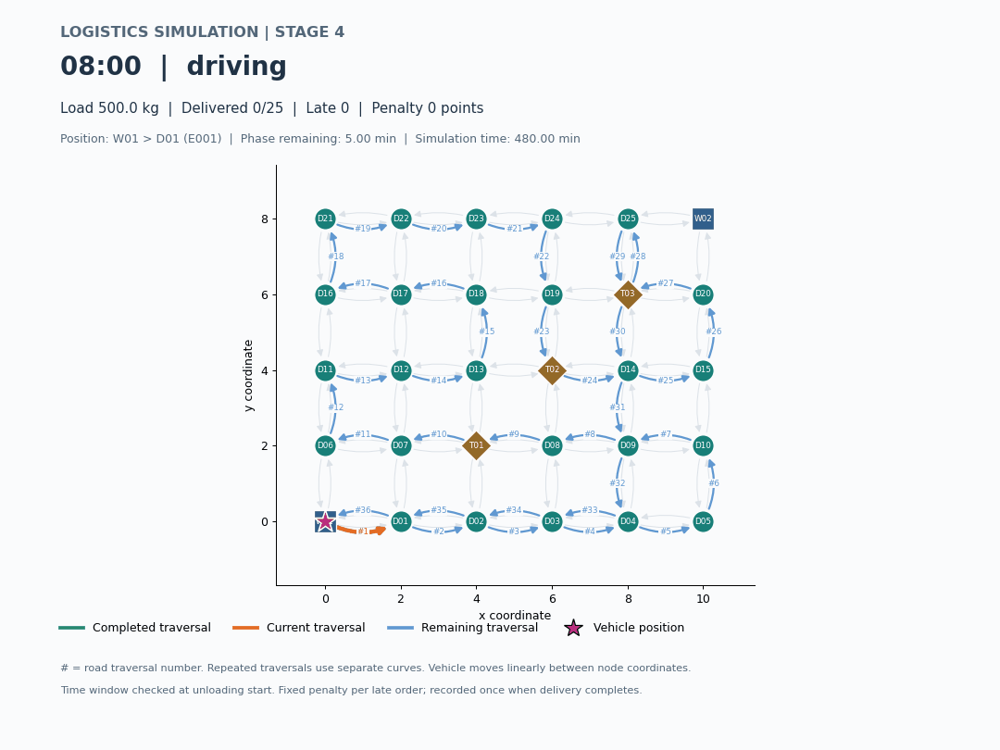

# 第 4 阶段仿真演示

采用原有 30 节点、98 道路网络和距离策略。从 W01 出发，车辆 V01 载重上限 1000 kg，初始货物 500 kg，完成 25 个配送点后返仓。

参数：08:00 出发，每步 5 分钟，每单卸货 2 分钟，每个超时订单固定处罚 10 分。窗口按开始卸货时刻判定，处罚在完成配送时计入一次。时间步长内的所有事件按真实模拟时刻处理。

| 结果 | 数值 |
| --- | --- |
| 返仓时间 | 13:21 |
| 总历时 | 321 分钟 = 行驶 202 + 等待 69 + 卸货 50 |
| 道路总距离 / 运输成本 | 72 km / 86.10 元 |
| 配送完成 / 剩余载荷 | 25 单 / 0 kg |
| 超时 | D20：17 分钟；D25：1 分钟 |
| 处罚 | 每单 10 分，合计 20 分，与成本分开 |

[完整运行日志](simulation-log.txt) · [配送记录](data/deliveries.csv) · [逐步位置](data/simulation.csv) · [精确事件](data/events.csv) · [仿真参数](data/simulation_options.csv)





绿色为已走道路遍历，橙色为当前段，蓝色为未走部分。星形标记车辆当前位置。GIF 是仿真快照回放，每帧 0.25 秒，不是真实墙钟时间；完整事件日志不会因采样而丢失事件。交互式窗口可拖动滑块、播放或暂停。

## 复现

在项目根目录完成编译及安装 `scripts/requirements.txt` 后运行：

```powershell
.\build\Debug\logistics_app.exe --plan distance --simulate --warehouse W01 --departure 480 --step 5 --capacity 1000 --unload-minutes 2 --late-penalty 10 --check-size --export exports/simulation
python scripts/plot_simulation.py --input-dir exports/simulation --frame 47 --output exports/vehicle.png --gif exports/simulation.gif
python scripts/plot_simulation.py --input-dir exports/simulation --show
```

命令写入 exports，不覆盖本目录示例。Linux/macOS 可执行文件通常为 `./build/logistics_app`。虚拟环境用相应环境的 Python。
