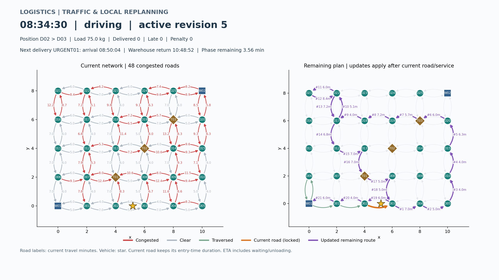

# 第 6 阶段：模拟路况与局部重规划

使用原有 30 节点、98 道路网络及 `config/orders.json`，08:00 从 W01 出发，车辆容量 100 kg、初始货物 60 kg、卸货 2 分钟。随机种子 42，每 30 模拟秒选取 10 条道路；畅通转拥堵时耗时为初始值的 1.2～2.0 倍，恢复时还原。以下数值来自 Windows / MSVC 19.29 本次实际运行；不同标准库的 shuffle/分布实现可能产生不同随机序列。

## 结果

| 项目 | 本次结果 |
| --- | --- |
| 已完成订单 | 4 |
| 超时 / penalty | 0 单 / 0 分 |
| 紧急单实际取货 | 08:13，W01，载荷增至 75 kg |
| 紧急单开始卸货 | 08:50:04，D05，早于 09:02 截止 |
| 返回 W01 | 10:56:08（656.125027677 模拟分钟） |
| 路况批次 / 边更新 | 352 / 3520 |
| 含触发边的批次 | 351 |
| 实际执行的区间最短路搜索 | 249 |
| 无受影响未来区间、零搜索的触发批次 | 171 |
| 候选道路序列发生改变的批次 | 96 |
| 最终已生效路线版本 | 29（含初始版本和动态插单；多次候选可在当前边结束前被替换） |

08:03 的 2000 kg 请求和 08:04 的过紧时间窗口请求仍被拒绝；原有已接受任务全部保留。窗口无法满足及实际固定处罚由 `traffic.unavoidable_late` 测试覆盖，本例并未故意制造迟到。

首次重规划发生在 **08:00:30**，车辆仍行驶于 W01 → D06，计划衔接点是 08:06 的 D06。仅搜索两个受影响的配送区间，候选路线中的一段从：

```text
D12 -> D07 -> D01 -> D02 -> D03
```

调整为：

```text
D12 -> D07 -> T01 -> D08 -> D03
```

其他区间保留。后来 08:02 新订单插入，候选路线再次改变；这次早期候选不一定会成为实际执行路线。实际生效版本、候选路径和已走道路分别记录，避免把待执行计划误报成实际行程。

## 文件与截图

- [完整运行日志](run-log.txt)：交通变化、重规划原因、前后路径、车辆、ETA 和最终订单结果。
- [路况历史](data/traffic.csv)、[重规划对比](data/replans.csv)、[订单结果](data/deliveries.csv)、[接单决定](data/insertions.csv)。
- `data/` 保存全部 14 份 CSV，可直接回放；`route_revisions.csv` 是生效路线，`remaining_routes.csv` 是逐帧的未来路径，`traversals.csv` 保存跨版本真实行驶记录。
- 截图选择第 80 帧，即 08:34:30。车辆在 D02 → D03 中途；左图红色为拥堵，右图紫色为更新后的剩余路径，橙色为当前边，绿色为已走道路，星形为车辆位置。



## 复现

项目根目录构建完成后：

```powershell
.\build\Debug\logistics_app.exe --plan distance --simulate --scenario config/orders.json --capacity 100 --traffic --traffic-seed 42 --export exports/traffic
python -m pip install -r scripts/requirements.txt
python scripts/plot_traffic.py --input-dir exports/traffic --frame 80 --output exports/traffic.png
python scripts/plot_traffic.py --input-dir exports/traffic --show
```

直接查看本次保存数据：

```powershell
python scripts/plot_traffic.py --input-dir docs/examples/stage6/data --frame 80 --output exports/saved-traffic.png --show
```

Linux/macOS 使用 `./build/logistics_app`；使用 Python 虚拟环境时替换对应 python 路径。图形显示的是导出状态的回放，不与运行中的 C++ 进程通信。程序日志中的 HH:MM 保留原格式，小数分钟字段及回放界面可辨识 30 秒事件。

## 检查

84 项 CTest 和 23 项 Python 标准库测试全部通过。对 20 张随机小图的三种权重、全部源终点组合共 2940 组最短路，与 Floyd–Warshall 交叉核对，同时比较单源和目标提前停止结果。已实际生成并查看本页 PNG；滑块/播放处理可运行，但没有将人工点击桌面窗口作为自动化验收。

局部性由专门测试验证：受影响 A → B 绕行 A → T → B，未受影响 B → W 保留，哪怕存在更快的 B → T → W。此策略减少重搜范围，不承诺全局最优路线或每次恢复畅通后立即寻找新捷径。
