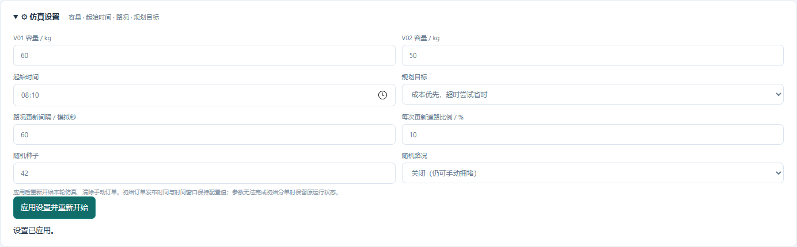

# 配送顺序优化与选路规则

## 两个层次

Dijkstra 决定两个停靠点之间走哪些道路；DynamicOrder 决定取送任务的访问顺序。两点最短路不代表整个多点行程最优。

初始逐单插入、动态取送插入得到可行种子后，improve 尝试将一个未完成动作移动到其他位置，每轮选择最好的可行移动。最多 3 轮、累计 256 个候选；缓存复用点对查询。候选逐站检查取货先后、已装货状态、容量、全部窗口和返仓；无改善保留种子。只调整当前车辆剩余任务；当前道路、等待、卸货先完成，不跨车转单。

一般优化按距离或成本比较，同等目标选更早返仓；插入紧急单时以本单开始卸货时间为第一目标，再比较距离/成本和返仓时刻。初始按紧急程度、截止时间处理，但不保证每个紧急订单全局最早送达。

## 决策表

| 情况 | 实际行为 |
| --- | --- |
| 距离优先且窗口可满足 | 距离 Dijkstra，优化剩余任务的总距离 |
| 成本优先且窗口可满足 | 成本 Dijkstra，优化剩余任务的总成本 |
| 某候选按距离/成本会超时 | 同一动作序列改用耗时 Dijkstra，复查全部约束；通过才参与比较 |
| 新紧急单 | 两车分别试算并优化；优先本单更早开始卸货，再新增距离/成本，最后车辆 ID |
| 新普通单 | 两车分别试算；先新增目标代价，再返仓时刻、车辆 ID |
| 新订单无可行候选 | 拒绝插入，保留已有计划；启发式失败不代表数学上无解 |
| 路况增时至少 20% | 仅对包含触发道路的剩余取送区间按耗时重搜，不全局重排任务 |
| 正在行驶或服务 | 完成锁定阶段后衔接新路径，不瞬移、不修改入边耗时 |
| 已接订单因后续路况实际迟到 | 继续执行；开始卸货时计算迟到，完成时按向上取整分钟记罚 |

距离/成本均可按时，系统尊重所选目标，并非始终省时优先。省时兜底和任务移动均为启发式，不保证全局最优，不枚举所有取送组合；此次不将处罚分与运输费用混合加权。

## 设置与证据

定向环路单测中，种子 W→C→B→A→W 的最短路拼接总距离为 12，优化后 W→A→B→C→W 为 4；这是说明性构造，不代表任意网络均有同等提升。新增测试检查改善、窗口保留、任务完整、卸货后载重及失败种子；原有在途插单、载重、窗口、双车归属和路况回归继续执行。
