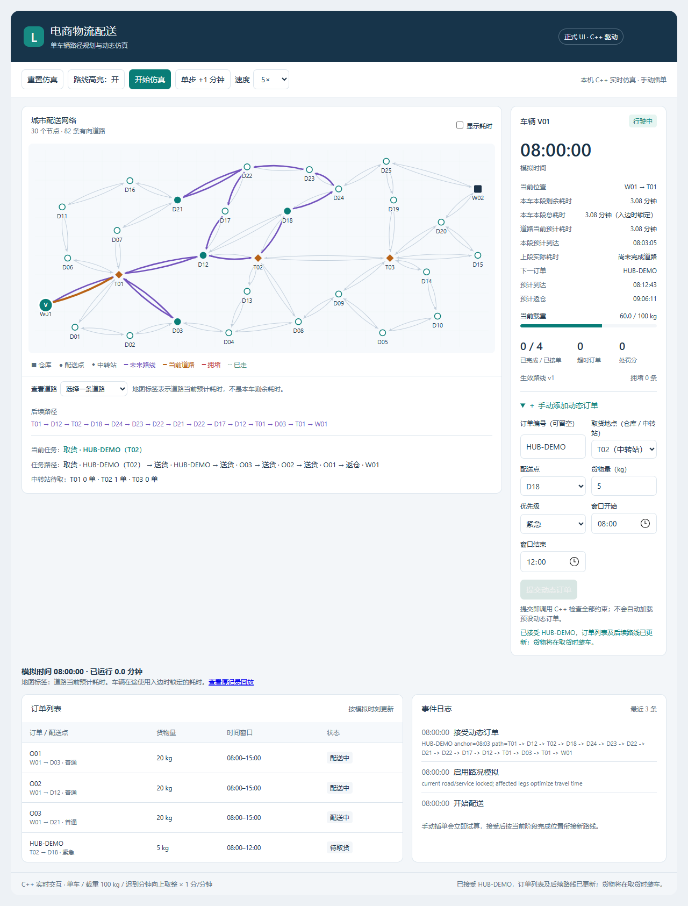
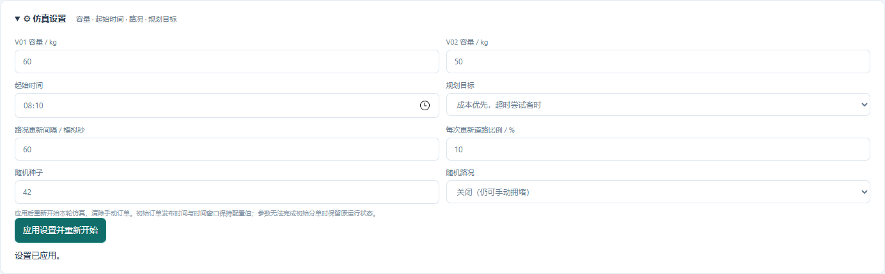

# 正式双车 Web 界面

正式界面采用已批准的独立双车 Demo 视觉和交互，默认 V01/V02 每车 40 kg。页面调用真实 C++17 FleetSimulation，Python 标准库只负责本机 HTTP 与进程通信，不在浏览器中替代路径算法。



## 启动

需要 Python 3.9+、CMake 3.16+ 和 C++17 编译器。Windows 双击根目录 Start-UI.cmd，或运行：

```sh
python scripts/start_ui.py
```

启动器构建 logistics_ui_bridge、生成网页并打开 http://127.0.0.1:8765/ 。此地址现在就是正式双车系统，不需要另开独立 Demo。保持终端运行，Ctrl+C 关闭；只监听本机。已有构建可加 --no-build，--no-browser 不自动打开浏览器，--port 可换端口，--build-dir 可改构建目录，LOGISTICS_UI_BRIDGE 可指定桥接路径。

普通运行无需 npm、matplotlib 或外网服务。标准 CMake 默认构建 CLI 和桥接；只需 CLI 可设 -DLOGISTICS_BUILD_UI=OFF。CLI 仍可选择单车或双车，网页默认双车。

## 布局与操作

- 顶部为共享时钟、开始/暂停、单步和速度；推进一次同时更新两车。初始订单来自 config/orders.json，不自动发布文件中的预设动态单。
- 地图同时显示蓝色 V01 和橙色 V02，可按车辆聚焦；另一辆始终保留。当前道路用实线、未来路径用虚线，红色显示拥堵。道路标签可选当前耗时或距离，选择道路可查看权重并“模拟该路拥堵”（当前耗时增加 80%）。
- 两张车辆卡片分别显示位置、入边锁定耗时与剩余时间、载重、下一单/返仓 ETA、后续道路路径、当前任务和取送任务路径。实际返仓后显示空闲与本车真实完成时刻。
- 订单表保留所属车辆、取货/配送节点、窗口、状态、实际迟到与处罚。日志可筛选两车、订单分配、共享路况；路线对比显示最近插单或拥堵修复的前后结果。
- 窄屏纵向排列卡片，地图支持横向滑动，表格在自身区域滚动。聚焦按钮和车辆卡片支持键盘操作。

## 手动订单与中转站

表单选择 W01/W02 仓库或 T01/T02/T03 中转站、配送点、数量、优先级、时间窗口。ID 可留空自动生成；提交会暂停播放。系统分别试算两车，只向选中的车正式插入，已有归属不变。拒绝时展示两车的约束失败原因，不改变原任务或载荷。

示例：T02 → D18，5 kg，08:00—12:00，紧急。成功后卡片显示“取货 · 订单ID（T02）”，中转站待取数量增加。车辆到站执行取货才装货，过路不装货；之后送达并返回本车原仓库。货物在订单发布时已备妥，暂不模拟库存补货。初始 O01/O02 分给 V01、O03 分给 V02，容量各 40 kg。

## 耗时、处罚与状态

默认每 30 秒模拟时间统一更新约 10% 道路。路况改变两车读取的同一份网络，当前已进入道路的耗时保持锁定，之后进入的道路使用新权重。卡片的剩余时间与地图道路当前耗时含义不同。

窗口以开始卸货时判断，早到等待；迟到分钟向上取整，每分钟处罚 1 分，费用另计。双车既有订单归属固定，不拆单、不跨车交接。

本机服务持有一个共享车队实例，多标签页操作同一状态；刷新保留订单、任务与最近已接受插入的前后路线。页面暂停时不会自行推进；其他标签页操作后可刷新查看。重置清除本轮手动订单，关闭服务不持久保存本轮状态。

## 回放与验证

页脚“查看历史单车回放”保留 393 帧旧记录，与当前车队状态独立，不改变当前运行。

```sh
cmake --build build --config Release
ctest --test-dir build -C Release --output-on-failure
node ui/verify_live.cjs
node ui/verify_hubs.cjs
```

浏览器脚本需先启动 8765 服务，并使用 ui/package.json 固定的 Playwright（或设置 DEMO_PLAYWRIGHT 为已安装模块路径）；Windows 使用 Edge。脚本会重置本轮仿真。单元/HTTP 检查只依赖 Python 标准库与已构建桥接，已纳入 CTest。最新记录见 [正式双车 UI 验证](reports/fleet-ui-integration.md)。

## 仿真设置面板

控制栏下展开“仿真设置”，分别设置 V01/V02 容量（0.01～100000 kg）、起始时间（当天 HH:mm）、距离/成本目标、随机路况开关、间隔（1～3600 模拟秒）、比例（0.01～100%）和整数种子（0～4294967295）。默认值保持原先的 40/40 kg、08:00、距离、开启、30 秒、10%、42。

应用后重建本轮并清除手动订单；初始订单发布时间和窗口仍取自 orders.json，不随起始时刻平移。无法装下初始货物或无法按时送达时拒绝新设置，原运行状态与已应用参数保持不变。重置沿用最近成功应用的参数，刷新可读取参数；关闭服务后恢复默认，不做持久化。随机路况关闭仍可手动模拟拥堵。



配送顺序已增加有限轮次局部移动，未执行旧任务可在保持约束下调整顺序。完整规则见 [选路策略](route-strategy.md)。
